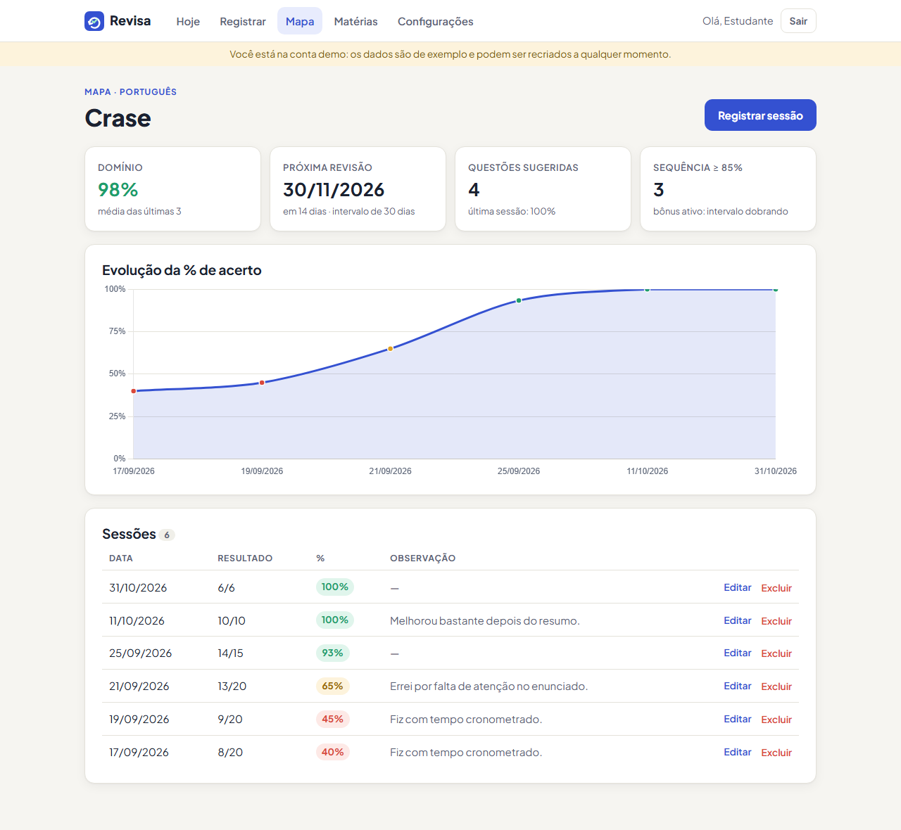
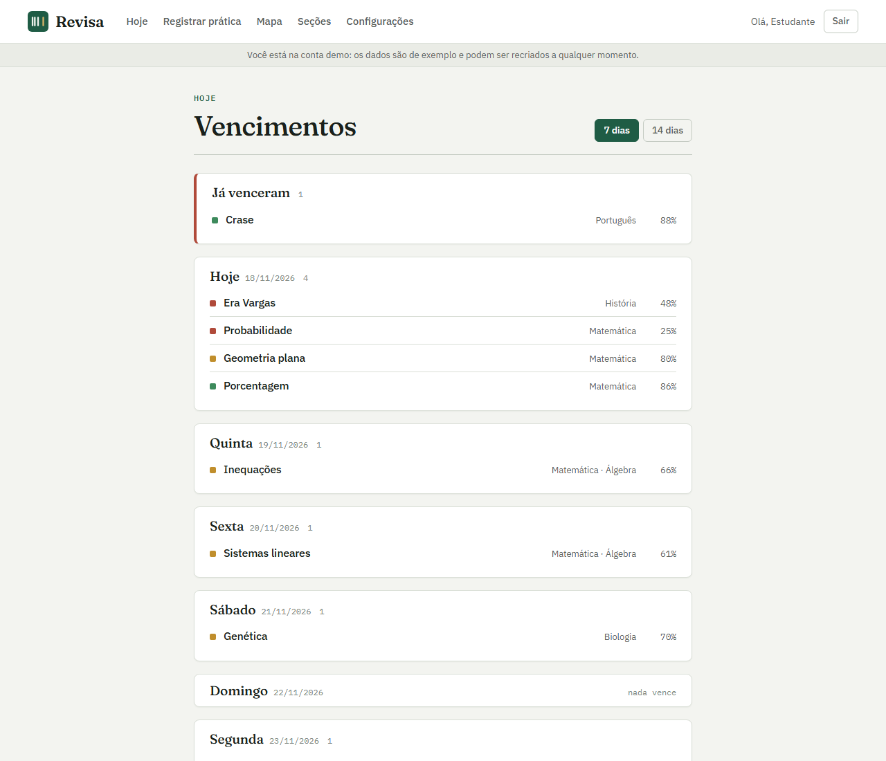
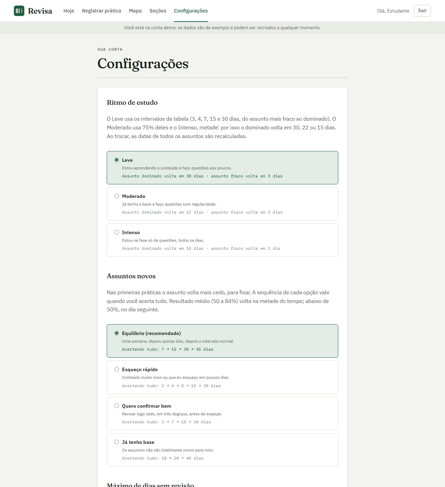

# Revisa · repetição espaçada para estudos

Aplicação web multiusuário que organiza as revisões de estudo com **repetição espaçada**.
A cada prática você registra quantas questões fez e quantas acertou; o Revisa calcula o
domínio de cada assunto, decide quando ele deve voltar e quantas questões fazer, e monta
a revisão do dia.

Feito em Python + Flask + SQLite, com interface em português, responsiva e sem frameworks pesados.
Roda localmente (um clique no `iniciar.bat`) ou online no PythonAnywhere.


---

## Funcionalidades

- **Contas de usuário**: cadastro, login e logout, senhas com hash. Cada usuário só vê e edita os próprios dados (checado no backend em todas as rotas).
- **Onboarding** no primeiro acesso, antes de entrar no app: ritmo de estudo, fase de aprendizado, máximo de dias sem revisão, como as seções se distribuem na semana (todas todo dia, dias por seção ou ciclo de estudos), modo de revisão, dia fixo, limite por seção e questões por assunto.
- **Hoje (painel)**: números do dia (revisões feitas, questões sugeridas, atrasados, domínio médio), a lista de revisões com registro direto na linha (acertos + Enter), uma prévia de **amanhã**, os **vencimentos** dos próximos 7 dias e o progresso nos assuntos ainda não começados.
- **Registrar prática**: formulário rápido (seção → assunto, data, acertos, total, observação).
- **Mapa de domínio**: uma lista só, por seção, com barra colorida (vermelho < 50%, amarelo 50–84%, verde ≥ 85%) e o status de cada assunto. Os contadores do topo (*Revisar agora*, *Pode esperar*, *Dominado*) servem de filtro.
- **Histórico do assunto**: lista de práticas (editar/excluir) e gráfico de linha da % de acerto (Chart.js).
- **Seções, assuntos e subassuntos**: a seção agrupa o que se estuda junto (ex.: SAT Math); os assuntos aparecem em cartões lado a lado, com os subassuntos dentro. Cada seção tem seus **dias de estudo** (todo dia ou dias escolhidos) e um modo de edição próprio.
- **Configurações**: tudo do onboarding, mais **exportar** e **importar** os dados em JSON.
- **Instalável como app** (PWA): no Chrome/Edge aparece "Instalar Revisa" na barra de endereço; no celular, "Adicionar à tela inicial".
- **Conta demo** com dados de exemplo (`demo@demo.com` / `demo123`).
- Proteção CSRF em todos os formulários, validação de dados (acertos ≤ total, total > 0) e datas no formato dd/mm/aaaa.

## Telas

| Landing | Onboarding |
|---|---|
|  |  |

| Mapa de domínio | Histórico do assunto |
|---|---|
|  |  |

| Registrar prática | Seções e assuntos |
|---|---|
|  |  |

| Vencimentos da semana | Assunto com subassuntos |
|---|---|
|  |  |

| Configurações |
|---|
|  |

---

## O algoritmo

Toda a lógica fica em [`logica.py`](logica.py), com funções puras (sem Flask nem banco) e
testes em [`tests/test_logica.py`](tests/test_logica.py).

### 1. Domínio do assunto

Média ponderada da % de acerto das **últimas 3 práticas**. O peso de cada prática combina duas coisas:

- **Posição**: 50% para a mais recente, 30% para a anterior e 20% para a antepenúltima.
- **Tamanho**: práticas com 10 questões ou mais têm peso cheio; com menos, o peso é proporcional
  (2 questões = 0,2 do peso). Assim, errar 1 de 2 questões não pesa o mesmo que errar 10 de 20.

Os pesos são normalizados para somar 1 (com menos de 3 práticas, ou com práticas pequenas, o que sobra é redistribuído):

```
peso_i    = peso_posição_i × min(1, questões_i / 10)
domínio   = Σ (acerto_i × peso_i) / Σ peso_i
```

### 2. Intervalo e questões sugeridas

A tabela é aplicada ao **domínio** (e não só à última prática), então a mudança é gradual:

| Domínio  | Próxima revisão | Questões |
|----------|-----------------|----------|
| < 50%    | 3 dias          | 20       |
| 50–69%   | 4 dias          | 15       |
| 70–84%   | 7 dias          | 10       |
| 85–94%   | 15 dias         | 6        |
| ≥ 95%    | 30 dias         | 4        |

- **Bônus**: com 2 ou mais práticas seguidas ≥ 85% (e domínio ≥ 85%), o intervalo anterior **dobra** a cada nova prática boa (15 → 30 → 60 …). O intervalo nunca fica abaixo do da tabela e é limitado pelo máximo de dias escolhido pelo usuário (no máximo 1 ano).
  - O bônus é proporcional ao tamanho da prática: só dobra se você fez pelo menos as questões sugeridas. Com menos, cresce na proporção (`1 + feitas/sugeridas`): acertar 1 de 1 quando o app sugeria 6 leva 30 dias para 35, não para 60.
- Uma prática abaixo de 85% encerra a sequência, e o intervalo volta ao da tabela para o domínio atual.
- Se o usuário escolheu **número fixo** de questões, ele substitui a coluna "Questões".

**Exemplo.** Um assunto vinha de duas práticas de 20 questões com 90% (revisão em 30 dias, pelo bônus):

| Nova prática | Domínio | Próxima revisão |
|---|---|---|
| acertou 1 de 2 (50%) | 83% | 7 dias |
| de novo, 1 de 2 | 72% | 7 dias |
| de novo, 1 de 2 | 50% | 4 dias |
| *em vez disso:* 10 de 20 (50%) | 70% | 7 dias |

Uma prática pequena e ruim mexe pouco; várias seguidas levam o assunto para o fundo da tabela.

**Fase de aprendizado.** Um assunto novo não vai direto para 30 dias, mesmo com 100% de acerto:
nas primeiras práticas ele volta mais cedo, em degraus. O usuário escolhe a opção no onboarding e em
Configurações. A sequência abaixo é para quando se acerta tudo:

| Opção | Tetos | Acertando tudo |
|---|---|---|
| Equilíbrio (padrão) | 7, 15 | 7 → 15 → 30 → 60 dias |
| Esqueço rápido | 2, 4, 8, 15 | 2 → 4 → 8 → 15 → 30 dias |
| Quero confirmar bem | 3, 7, 15 | 3 → 7 → 15 → 30 dias |
| Já tenho base | 10, 20 | 10 → 20 → 40 dias |

Em cada degrau, o resultado decide quanto do teto vale:

| Resultado (domínio) | Volta em | Ex.: "Quero confirmar bem" |
|---|---|---|
| Bom (≥ 85%) | o teto do degrau | 3 dias |
| Médio (50 a 84%) | metade do teto, para cima | 2 dias |
| Mal (< 50%) | 1 dia | 1 dia |

**Ritmo de estudo.** Escolhido no onboarding e em Configurações, multiplica o intervalo final
(inclusive bônus e fase de aprendizado):

| Ritmo | Para quem | Fator | Tabela |
|---|---|---|---|
| Leve | estudando conteúdo + questões | ×1 | 3 · 4 · 7 · 15 · 30 dias |
| Moderado | rotina regular de questões | ×0,75 | 2 · 3 · 5 · 11 · 22 dias |
| Intenso | fase só de questões | ×0,5 | 1 · 2 · 3 · 7 · 15 dias |

Como tudo é calculado a partir do histórico, trocar o ritmo recalcula na hora as datas de todos os
assuntos.

**Máximo de dias sem revisão.** Por mais que o bônus cresça, nenhum assunto fica mais tempo sem
revisão do que o teto escolhido pelo usuário. No onboarding o app sugere um valor pelas respostas
(ritmo Leve 60, Moderado 45, Intenso 30; "esqueço rápido" −15, "já tenho base" +15), e a pessoa
pode aceitar ou trocar (30, 45, 60, 90 ou qualquer número entre 7 e 365). A opção **Livre (até 1 ano)**
é para quem estuda a longo prazo, sem prova marcada: a cada revisão bem-feita o intervalo dobra
(30 → 60 → 120 → 240 dias) até no máximo 365.

### 3. Esquecimento

Se a revisão atrasar, o domínio cai **5 pontos percentuais por semana completa** de atraso (mínimo 0):

```
domínio_efetivo = max(0, domínio − 0,05 × ⌊dias_de_atraso / 7⌋)
```

### 4. Prioridade

```
prioridade = (1 − domínio_efetivo) + dias_de_atraso × 0,1
```

Assuntos com domínio baixo e assuntos atrasados sobem na fila. As revisões são mostradas da maior para a menor prioridade.

### 5. Montagem da revisão

| Modo | No dia fixo | Nos outros dias |
|---|---|---|
| Todo dia, o que vencer (com limite) | — | O que venceu, até N por seção |
| Todo dia, tudo que vencer | — | Tudo que venceu, sem limite |
| Só no dia fixo | Revisão grande | Sem revisão |
| Dia fixo + limite nos outros dias | Revisão grande | O que venceu, até N por seção |

- **Limite por seção**: entra só o que já venceu, até N assuntos **de cada seção** (padrão 2), começando pelos que mais precisam (maior prioridade). O que passar do limite continua vencido e entra nos dias seguintes. Nada é revisado antes do vencimento: esperar o momento certo faz parte da repetição espaçada.
- **Revisão grande**: tudo que já venceu e não foi feito + tudo que vence antes do próximo dia fixo, por prioridade, sem limite de questões.
- A seleção do dia usa só as práticas **anteriores a hoje**, então a lista não muda enquanto você registra os resultados; o que já foi feito aparece marcado.
- A **observação** de cada prática é só um registro: não entra em nenhum cálculo.

### 6. Dias de estudo por seção

Quem escolhe "Cada seção tem seus dias" define, para cada seção, se ela é estudada todo dia ou só em alguns dias (ex.: SAT todo dia, teoria musical
seg/qua/sex). Nos outros dias, os assuntos dela não entram na revisão. E se uma revisão cairia
num dia sem estudo daquela seção, ela passa para o próximo dia de estudo **sem contar como atraso**,
então o esquecimento e a prioridade não punem os dias de folga daquela seção.

### 7. Ciclo de estudos

Para quem não quer amarrar seção a dia da semana (ex.: ENEM com muitas matérias). A pessoa monta
uma **fila** de seções na tela Seções (uma seção pode aparecer mais de uma vez, para ter mais peso)
e diz quantas estuda por dia. Cada dia, as **seções da vez** são as próximas da fila:

- registrar uma prática numa seção da vez marca aquela vez como feita; no dia seguinte a fila anda;
- se a pessoa não estuda num dia, **a fila espera** (nada atrasa);
- dá para **pular** uma seção no dia; a próxima da fila entra no lugar;
- a revisão do dia só traz assuntos das seções da vez, e a espera até a seção chegar na vez
  (até uma volta do ciclo) **não conta como atraso**.

### 8. Subassuntos

A hierarquia é **seção → assunto → subassunto** (um nível de subassunto). Quando um assunto ganha
subassuntos, ele vira um **grupo**: as práticas são registradas nos subassuntos, e só eles entram nas
revisões e no mapa. O domínio do grupo é a **média simples** do domínio efetivo dos subassuntos já
estudados. Cada um pesa igual, para que um ponto fraco (ex.: inequações) não fique escondido atrás
de um ponto forte (ex.: equações).

---

## Tecnologias

- **Python 3.10+**, **Flask 3**, **Flask-Login**
- **SQLite** (arquivo `estudos.db`, criado automaticamente na primeira execução)
- **Werkzeug** para hash de senhas
- **Jinja2**, HTML, CSS e JavaScript puro
- **Chart.js** (via CDN) no gráfico do histórico
- **unittest** para os testes

## Estrutura

```
revisa/
├── app.py                 # rotas, autenticação, CSRF, comando seed-demo
├── logica.py              # algoritmo de repetição espaçada (funções puras)
├── servicos.py            # consultas por usuário + montagem das telas, exportar/importar
├── db.py                  # conexão SQLite e esquema
├── seed.py                # dados da conta demo
├── templates/             # páginas Jinja
├── static/                # CSS, JS e ícone
├── tests/                 # testes da lógica e das rotas
├── iniciar.bat            # atalho para rodar no Windows
├── pythonanywhere_wsgi.py # exemplo de WSGI para o deploy
├── requirements.txt
└── .env.example
```

---

## Como rodar localmente

### Windows (jeito rápido)

Dê dois cliques em **`iniciar.bat`**. Na primeira vez ele cria um ambiente virtual, instala as
dependências e copia `.env.example` para `.env`. Depois abre o navegador em
<http://127.0.0.1:5000>. Para parar, feche a janela do terminal.

### Qualquer sistema

```bash
git clone https://github.com/isabelasantosgoncalves/repeticao-espacada-para-estudos.git revisa
cd revisa
python -m venv .venv
# Windows: .venv\Scripts\activate    Linux/macOS: source .venv/bin/activate
pip install -r requirements.txt
cp .env.example .env        # e troque a SECRET_KEY
python app.py               # http://127.0.0.1:5000
```

### Conta demo

```bash
flask seed-demo
```

Cria (ou recria do zero) a conta **demo@demo.com / demo123** com 4 matérias, 15 assuntos e
cerca de 60 práticas simuladas. Na landing page há um link "Entrar na conta demo".

### Testes

```bash
python -m unittest -v
```

Cobrem tabela de intervalos, bônus, domínio, esquecimento, prioridade, seleção das revisões diária e grande,
além de login obrigatório, CSRF, isolamento entre usuários, validação e exportar/importar.

### Variáveis de ambiente (`.env`)

| Variável | Para que serve |
|---|---|
| `SECRET_KEY` | Chave que protege o login (cookies de sessão). Gere com `python -c "import secrets; print(secrets.token_hex(32))"` |
| `DATABASE_PATH` | Opcional. Caminho do banco (padrão: `estudos.db` na pasta do app) |
| `APP_TZ` | Fuso usado para saber qual é o "hoje" (padrão `America/Sao_Paulo`) |
| `FLASK_DEBUG` | `1` liga o modo debug local |

---

## Deploy no PythonAnywhere (passo a passo)

1. **Crie uma conta** gratuita em <https://www.pythonanywhere.com>.
2. Abra um **Bash console** (aba *Consoles* → *Bash*) e baixe o código:
   ```bash
   git clone https://github.com/isabelasantosgoncalves/repeticao-espacada-para-estudos.git revisa
   cd revisa
   ```
3. **Crie o ambiente virtual** e instale as dependências:
   ```bash
   mkvirtualenv revisa --python=python3.10
   pip install -r requirements.txt
   ```
4. **Configure o `.env`**:
   ```bash
   cp .env.example .env
   python -c "import secrets; print(secrets.token_hex(32))"   # copie a chave gerada
   nano .env                                                  # cole em SECRET_KEY e salve
   ```
5. (Opcional) **Crie a conta demo**:
   ```bash
   flask seed-demo
   ```
6. Na aba **Web**, clique em *Add a new web app* → *Manual configuration* → **Python 3.10**.
7. Ainda na aba Web:
   - Em **Virtualenv**, informe `/home/SEUUSUARIO/.virtualenvs/revisa`.
   - Em **Source code**, informe `/home/SEUUSUARIO/revisa`.
   - Abra o link do **WSGI configuration file**, apague o conteúdo e cole o de
     [`pythonanywhere_wsgi.py`](pythonanywhere_wsgi.py), trocando `SEUUSUARIO` pelo seu usuário.
8. Em **Static files**, adicione: URL `/static/` → Directory `/home/SEUUSUARIO/revisa/static`.
9. Clique em **Reload**. O app estará em `https://SEUUSUARIO.pythonanywhere.com`.

Para atualizar depois: `cd ~/revisa && git pull` no console e **Reload** na aba Web.
O banco `estudos.db` fica na pasta do projeto e não vai para o Git. Use *Exportar meus dados* para fazer backup.

---

## Decisões de projeto

- **Lógica isolada**: `logica.py` não importa Flask nem SQLite, então o algoritmo é testado com dados simples e pode ser reaproveitado.
- **Segurança**: toda consulta filtra por `usuario_id`; recursos de outro usuário respondem 404. Formulários têm token CSRF, os cookies são `HttpOnly`/`SameSite=Lax` e o `?next=` do login só aceita caminhos internos.
- **Sem dependências pesadas**: SQLite puro (sem ORM) e JavaScript sem framework, para rodar até no plano gratuito do PythonAnywhere.
- **Importação segura**: o arquivo é validado inteiro antes de gravar; se algo estiver errado, nada muda.
