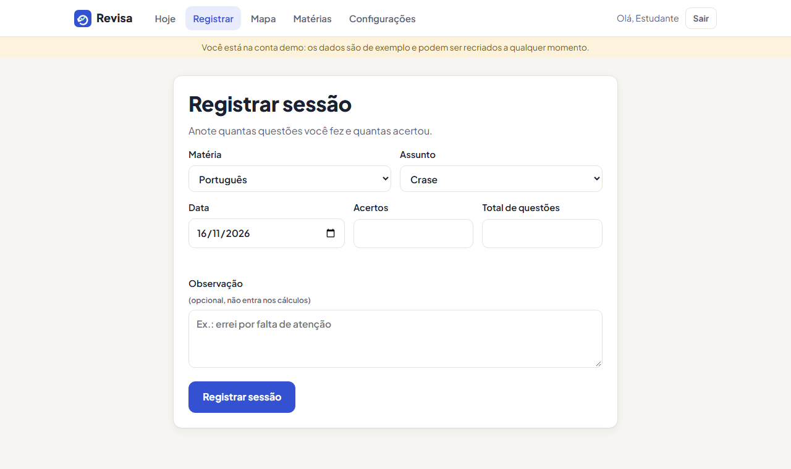

# Revisa · repetição espaçada para estudos

Aplicação web multiusuário que organiza as revisões de estudo com **repetição espaçada**.
A cada sessão você registra quantas questões fez e quantas acertou; o Revisa calcula o
domínio de cada assunto, decide quando ele deve voltar e quantas questões fazer, e monta
a revisão do dia.

Feito em Python + Flask + SQLite, com interface em português, responsiva e sem frameworks pesados.
Roda localmente (um clique no `iniciar.bat`) ou online no PythonAnywhere.


---

## Funcionalidades

- **Contas de usuário**: cadastro, login e logout, senhas com hash. Cada usuário só vê e edita os próprios dados (checado no backend em todas as rotas).
- **Onboarding** no primeiro acesso: modo de revisão, dia(s) fixo(s), revisão mínima diária e questões por assunto.
- **Hoje**: em três blocos, (1) a revisão do dia com a quantidade de questões de cada assunto, (2) a escolha do assunto novo e (3) o registro rápido dos resultados.
- **Registrar sessão**: formulário rápido (matéria → assunto, data, acertos, total, observação).
- **Mapa de domínio**: assuntos por matéria com barra colorida (vermelho < 50%, amarelo 50–84%, verde ≥ 85%), separados em *Revisar agora*, *Pode esperar* e *Dominado*.
- **Histórico do assunto**: lista de sessões (editar/excluir) e gráfico de linha da % de acerto (Chart.js).
- **Matérias e assuntos**: criar, renomear, mover e excluir.
- **Configurações**: tudo do onboarding, mais **exportar** e **importar** os dados em JSON.
- **Conta demo** com dados de exemplo (`demo@demo.com` / `demo123`).
- Proteção CSRF em todos os formulários, validação de dados (acertos ≤ total, total > 0) e datas no formato dd/mm/aaaa.

## Telas

| Landing | Onboarding |
|---|---|
|  |  |

| Mapa de domínio | Histórico do assunto |
|---|---|
|  |  |

| Registrar sessão | Matérias e assuntos |
|---|---|
|  |  |

| Configurações |
|---|
|  |

---

## O algoritmo

Toda a lógica fica em [`logica.py`](logica.py), com funções puras (sem Flask nem banco) e
testes em [`tests/test_logica.py`](tests/test_logica.py).

### 1. Domínio do assunto

Média ponderada da % de acerto das **últimas 3 sessões**. O peso de cada sessão combina duas coisas:

- **Posição**: 50% para a mais recente, 30% para a anterior e 20% para a antepenúltima.
- **Tamanho**: sessões com 10 questões ou mais têm peso cheio; com menos, o peso é proporcional
  (2 questões = 0,2 do peso). Assim, errar 1 de 2 questões não pesa o mesmo que errar 10 de 20.

Os pesos são normalizados para somar 1 (com menos de 3 sessões, ou com sessões pequenas, o que sobra é redistribuído):

```
peso_i    = peso_posição_i × min(1, questões_i / 10)
domínio   = Σ (acerto_i × peso_i) / Σ peso_i
```

### 2. Intervalo e questões sugeridas

A tabela é aplicada ao **domínio** (e não só à última sessão), então a mudança é gradual:

| Domínio  | Próxima revisão | Questões |
|----------|-----------------|----------|
| < 50%    | 2 dias          | 20       |
| 50–69%   | 4 dias          | 15       |
| 70–84%   | 7 dias          | 10       |
| 85–94%   | 15 dias         | 6        |
| ≥ 95%    | 30 dias         | 4        |

- **Bônus**: com 2 ou mais sessões seguidas ≥ 85% (e domínio ≥ 85%), o intervalo anterior **dobra** a cada nova sessão boa (15 → 30 → 60 …). O intervalo nunca fica abaixo do da tabela e tem um teto de segurança de 180 dias.
- Uma sessão abaixo de 85% encerra a sequência, e o intervalo volta ao da tabela para o domínio atual.
- Se o usuário escolheu **número fixo** de questões, ele substitui a coluna "Questões".

**Exemplo.** Um assunto vinha de duas sessões de 20 questões com 90% (revisão em 30 dias, pelo bônus):

| Nova sessão | Domínio | Próxima revisão |
|---|---|---|
| acertou 1 de 2 (50%) | 83% | 7 dias |
| de novo, 1 de 2 | 72% | 7 dias |
| de novo, 1 de 2 | 50% | 4 dias |
| *em vez disso:* 10 de 20 (50%) | 70% | 7 dias |

Uma sessão pequena e ruim mexe pouco; várias seguidas levam o assunto para o fundo da tabela.

### 3. Esquecimento

Se a revisão atrasar, o domínio cai **5 pontos percentuais por semana completa** de atraso (mínimo 0):

```
domínio_efetivo = max(0, domínio − 0,05 × ⌊dias_de_atraso / 7⌋)
```

### 4. Prioridade

```
prioridade = (1 − domínio_efetivo) + dias_de_atraso × 0,1
```

Assuntos com domínio baixo e assuntos atrasados sobem na fila. As revisões são mostradas da maior para a menor prioridade.

### 5. Montagem da revisão

| Modo | No dia fixo | Nos outros dias |
|---|---|---|
| Só fixa | Revisão grande | Sem revisão (só assunto novo) |
| Só diária | — | Revisão mínima |
| Fixa + diária | Revisão grande | Revisão mínima |

- **Revisão mínima diária**: o assunto estudado ontem + os assuntos de menor domínio efetivo, até completar N assuntos (padrão 2). Se o assunto de ontem também é o de menor domínio, ele entra uma vez só e a vaga vai para o próximo.
- **Revisão grande**: tudo que já venceu e não foi feito + tudo que vence antes do próximo dia fixo, por prioridade, sem limite de questões.
- A seleção do dia usa só as sessões **anteriores a hoje**, então a lista não muda enquanto você registra os resultados; o que já foi feito aparece marcado.
- A **observação** de cada sessão é só um registro: não entra em nenhum cálculo.

---

## Tecnologias

- **Python 3.10+**, **Flask 3**, **Flask-Login**
- **SQLite** (arquivo `estudos.db`, criado automaticamente na primeira execução)
- **Werkzeug** para hash de senhas
- **Jinja2**, HTML, CSS e JavaScript puro
- **Chart.js** (via CDN) no gráfico do histórico
- **unittest** para os testes

## Estrutura

```
revisa/
├── app.py                 # rotas, autenticação, CSRF, comando seed-demo
├── logica.py              # algoritmo de repetição espaçada (funções puras)
├── servicos.py            # consultas por usuário + montagem das telas, exportar/importar
├── db.py                  # conexão SQLite e esquema
├── seed.py                # dados da conta demo
├── templates/             # páginas Jinja
├── static/                # CSS, JS e ícone
├── tests/                 # testes da lógica e das rotas
├── iniciar.bat            # atalho para rodar no Windows
├── pythonanywhere_wsgi.py # exemplo de WSGI para o deploy
├── requirements.txt
└── .env.example
```

---

## Como rodar localmente

### Windows (jeito rápido)

Dê dois cliques em **`iniciar.bat`**. Na primeira vez ele cria um ambiente virtual, instala as
dependências e copia `.env.example` para `.env`. Depois abre o navegador em
<http://127.0.0.1:5000>. Para parar, feche a janela do terminal.

### Qualquer sistema

```bash
git clone https://github.com/isabelasantosgoncalves/repeticao-espacada-para-estudos.git revisa
cd revisa
python -m venv .venv
# Windows: .venv\Scripts\activate    Linux/macOS: source .venv/bin/activate
pip install -r requirements.txt
cp .env.example .env        # e troque a SECRET_KEY
python app.py               # http://127.0.0.1:5000
```

### Conta demo

```bash
flask seed-demo
```

Cria (ou recria do zero) a conta **demo@demo.com / demo123** com 4 matérias, 15 assuntos e
cerca de 60 sessões simuladas. Na landing page há um link "Entrar na conta demo".

### Testes

```bash
python -m unittest -v
```

Cobrem tabela de intervalos, bônus, domínio, esquecimento, prioridade, seleção das revisões diária e grande,
além de login obrigatório, CSRF, isolamento entre usuários, validação e exportar/importar.

### Variáveis de ambiente (`.env`)

| Variável | Para que serve |
|---|---|
| `SECRET_KEY` | Chave das sessões. Gere com `python -c "import secrets; print(secrets.token_hex(32))"` |
| `DATABASE_PATH` | Opcional. Caminho do banco (padrão: `estudos.db` na pasta do app) |
| `APP_TZ` | Fuso usado para saber qual é o "hoje" (padrão `America/Sao_Paulo`) |
| `FLASK_DEBUG` | `1` liga o modo debug local |

---

## Deploy no PythonAnywhere (passo a passo)

1. **Crie uma conta** gratuita em <https://www.pythonanywhere.com>.
2. Abra um **Bash console** (aba *Consoles* → *Bash*) e baixe o código:
   ```bash
   git clone https://github.com/isabelasantosgoncalves/repeticao-espacada-para-estudos.git revisa
   cd revisa
   ```
3. **Crie o ambiente virtual** e instale as dependências:
   ```bash
   mkvirtualenv revisa --python=python3.10
   pip install -r requirements.txt
   ```
4. **Configure o `.env`**:
   ```bash
   cp .env.example .env
   python -c "import secrets; print(secrets.token_hex(32))"   # copie a chave gerada
   nano .env                                                  # cole em SECRET_KEY e salve
   ```
5. (Opcional) **Crie a conta demo**:
   ```bash
   flask seed-demo
   ```
6. Na aba **Web**, clique em *Add a new web app* → *Manual configuration* → **Python 3.10**.
7. Ainda na aba Web:
   - Em **Virtualenv**, informe `/home/SEUUSUARIO/.virtualenvs/revisa`.
   - Em **Source code**, informe `/home/SEUUSUARIO/revisa`.
   - Abra o link do **WSGI configuration file**, apague o conteúdo e cole o de
     [`pythonanywhere_wsgi.py`](pythonanywhere_wsgi.py), trocando `SEUUSUARIO` pelo seu usuário.
8. Em **Static files**, adicione: URL `/static/` → Directory `/home/SEUUSUARIO/revisa/static`.
9. Clique em **Reload**. O app estará em `https://SEUUSUARIO.pythonanywhere.com`.

Para atualizar depois: `cd ~/revisa && git pull` no console e **Reload** na aba Web.
O banco `estudos.db` fica na pasta do projeto e não vai para o Git. Use *Exportar meus dados* para fazer backup.

---

## Decisões de projeto

- **Lógica isolada**: `logica.py` não importa Flask nem SQLite, então o algoritmo é testado com dados simples e pode ser reaproveitado.
- **Segurança**: toda consulta filtra por `usuario_id`; recursos de outro usuário respondem 404. Formulários têm token CSRF, os cookies são `HttpOnly`/`SameSite=Lax` e o `?next=` do login só aceita caminhos internos.
- **Sem dependências pesadas**: SQLite puro (sem ORM) e JavaScript sem framework, para rodar até no plano gratuito do PythonAnywhere.
- **Importação segura**: o arquivo é validado inteiro antes de gravar; se algo estiver errado, nada muda.
