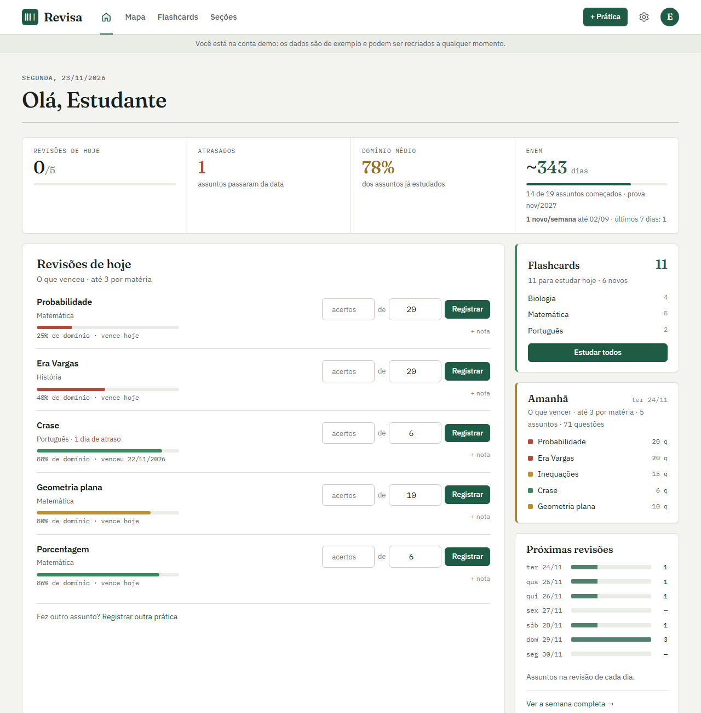
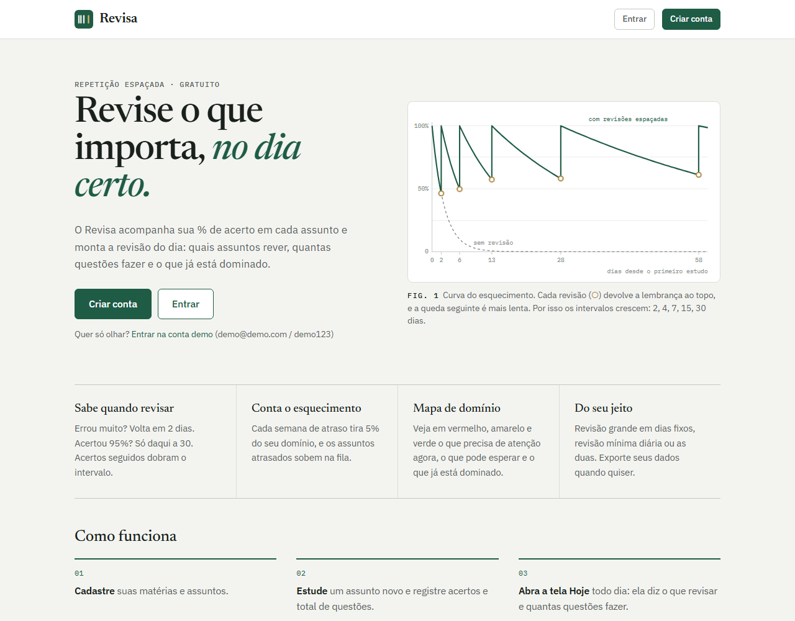
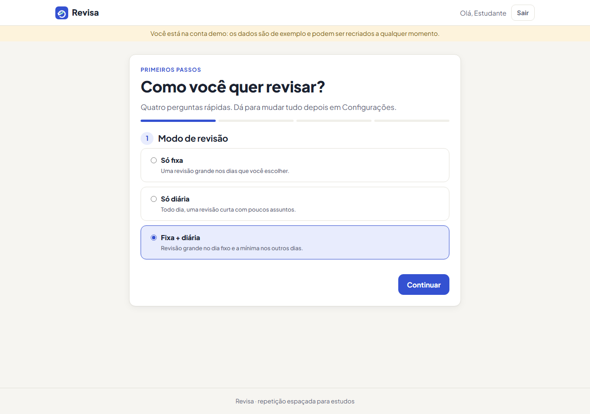
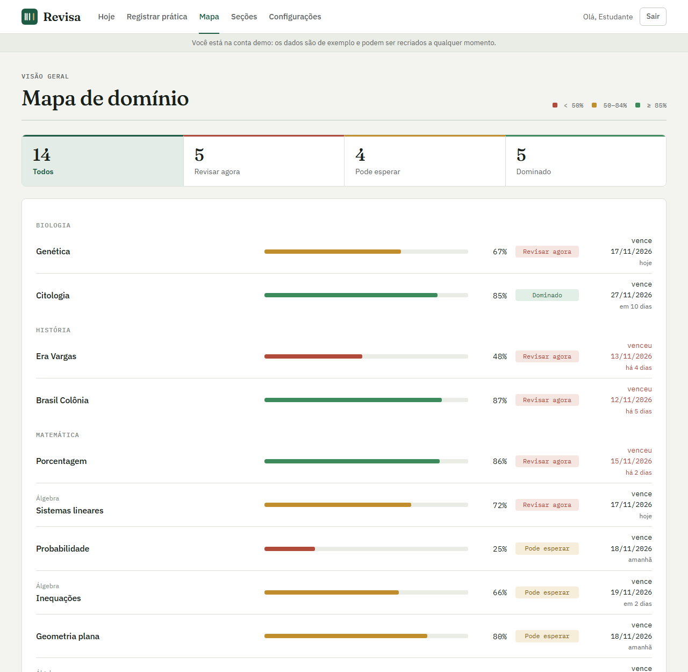
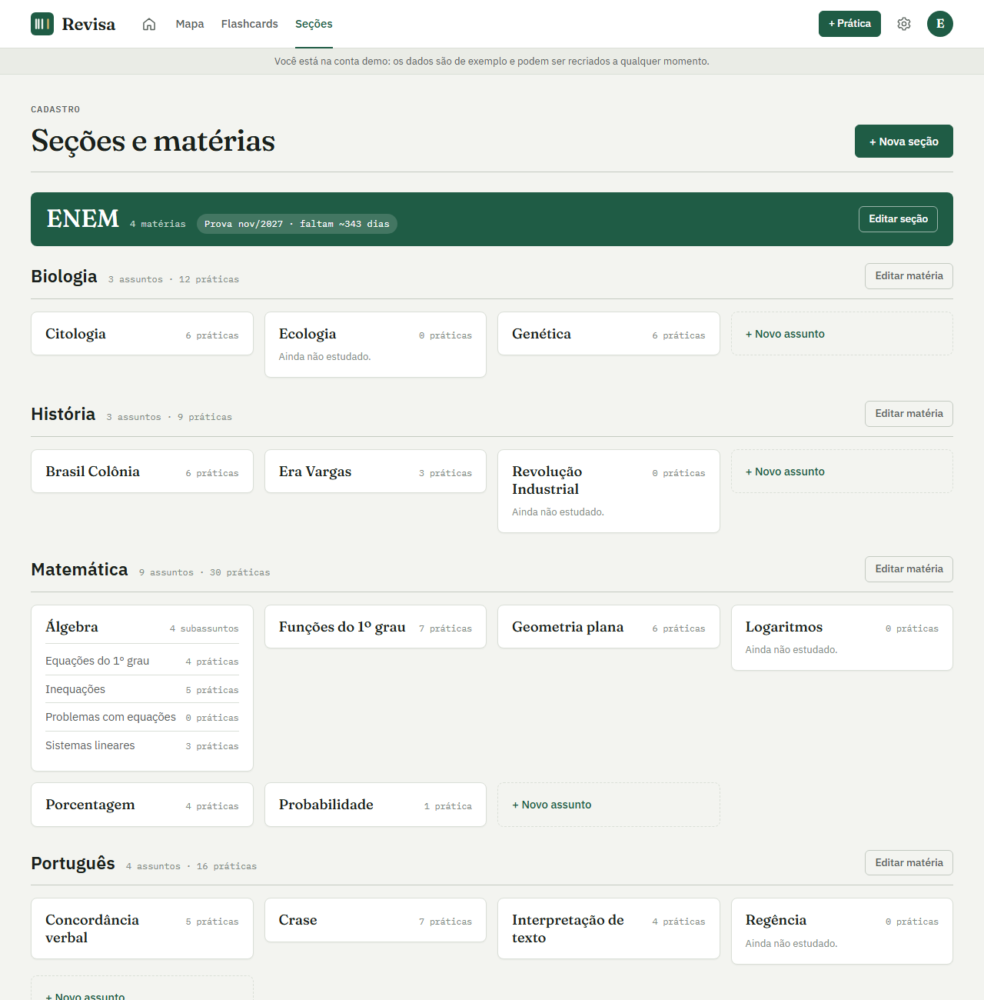
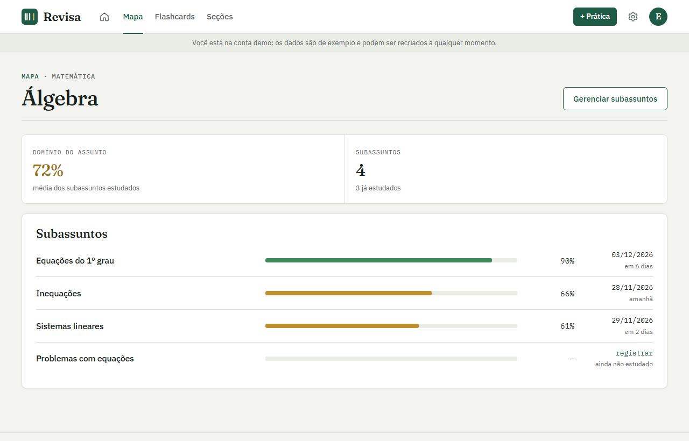
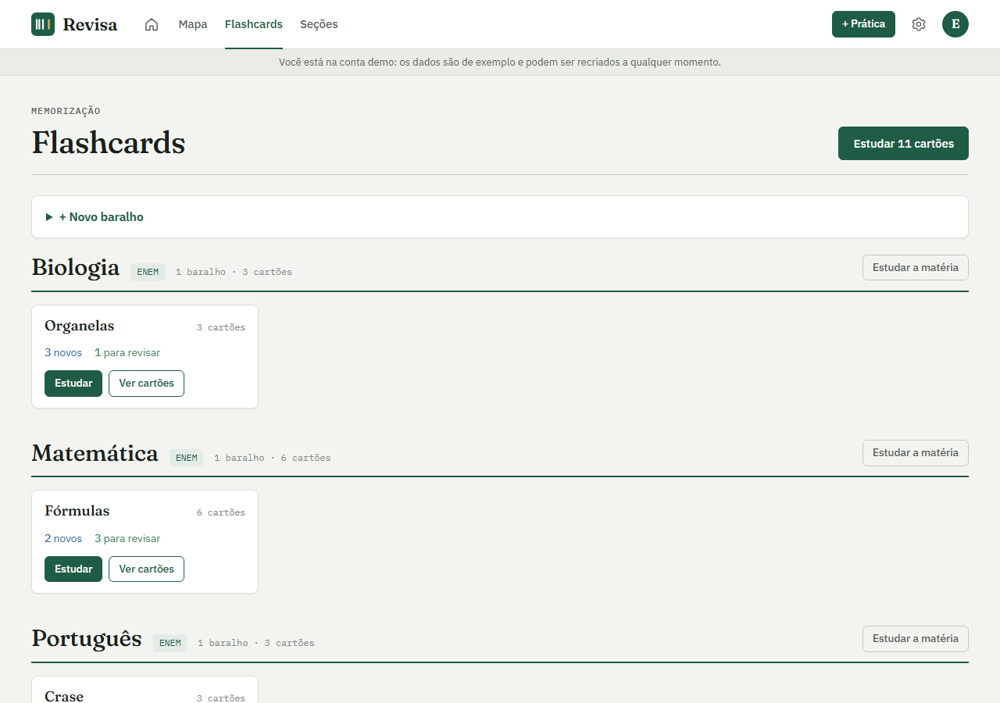
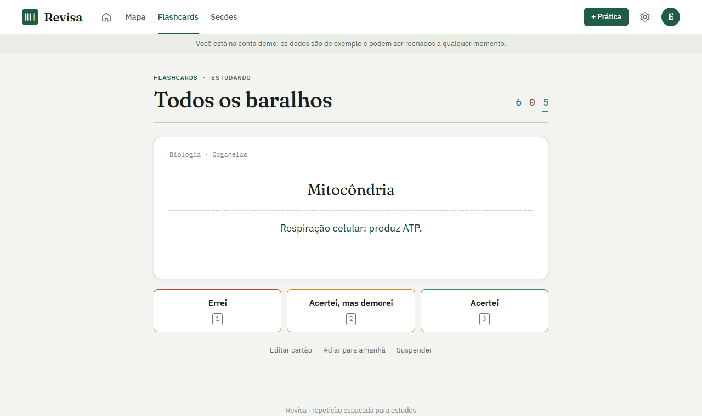

# Revisa · repetição espaçada para estudos

Aplicação web multiusuário que organiza as revisões de estudo com **repetição espaçada**.
A cada prática você registra quantas questões fez e quantas acertou; o Revisa calcula o
domínio de cada assunto, decide quando ele deve voltar e quantas questões fazer, e monta
a revisão do dia.

Feito em Python + Flask + SQLite, com interface em português, responsiva e sem frameworks pesados.
Roda localmente (um clique no `iniciar.bat`) ou online no PythonAnywhere.



---

## Funcionalidades

- **Contas de usuário**: cadastro, login e logout, senhas com hash. Cada usuário só vê e edita os próprios dados (checado no backend em todas as rotas).
- **Onboarding** no primeiro acesso, antes de entrar no app: ritmo de estudo, fase de aprendizado, máximo de dias sem revisão, se tem prova com data, como as matérias se distribuem na semana (todas todo dia, dias por matéria ou ciclo de estudos), modo de revisão, dia fixo, limite por matéria e questões por assunto.
- **Hoje (painel)**: números do dia (revisões feitas, atrasados, domínio médio e a contagem para cada prova), a lista de revisões com registro direto na linha (acertos + Enter), uma prévia de **amanhã**, as **próximas revisões** (a lista planejada de cada dia, com o limite por matéria) e o progresso nos assuntos ainda não começados.
- **Registrar prática**: formulário rápido (matéria → assunto, data, acertos, total, observação).
- **Mapa de domínio**: uma lista só, por matéria, com barra colorida (vermelho < 50%, amarelo 50–84%, verde ≥ 85%) e o status de cada assunto. Os contadores do topo (*Revisar agora*, *Pode esperar*, *Dominado*) servem de filtro.
- **Histórico do assunto**: lista de práticas (editar/excluir) e gráfico de linha da % de acerto (Chart.js).
- **Seções, matérias, assuntos e subassuntos**: a seção é o que você estuda (ex.: ENEM, SAT, Música); dentro dela ficam as matérias (Matemática, Biologia; SAT Math, SAT English), e dentro de cada matéria os assuntos, em cartões lado a lado, com os subassuntos dentro. Cada matéria tem seus **dias de estudo** (todo dia ou dias escolhidos) e um modo de edição próprio.
- **Data da prova** (opcional, na seção; dia exato ou só o mês): vale para todas as matérias da seção. Nenhuma revisão passa da prova, e o painel mostra a contagem regressiva e quantos assuntos novos começar por semana para terminar o conteúdo a tempo.
- **Flashcards**: baralhos dentro de cada matéria (ex.: Matemática → Fórmulas), cartões de frente e verso (com imagem, fórmula e opção de invertido; um a um ou vários de uma vez, colados de uma planilha) e uma tela de estudo no estilo do Anki: vira o cartão (espaço), responde **Errei**, **Acertei, mas demorei** ou **Acertei** (teclas 1 a 3), o que errou volta na mesma sessão, e dá para desfazer, editar, adiar e suspender. O painel Hoje mostra quantos cartões estudar, por matéria.
- **Configurações**: tudo do onboarding, mais **exportar** e **importar** os dados em JSON.
- **Instalável como app** (PWA): no Chrome/Edge aparece "Instalar Revisa" na barra de endereço; no celular, "Adicionar à tela inicial".
- **Conta demo** com dados de exemplo (`demo@demo.com` / `demo123`).
- Proteção CSRF em todos os formulários, validação de dados (acertos ≤ total, total > 0) e datas no formato dd/mm/aaaa.

## Telas

| Landing | Onboarding |
|---|---|
|  |  |

| Mapa de domínio | Histórico do assunto |
|---|---|
|  |  |

| Registrar prática | Seções e matérias |
|---|---|
|  |  |

| Próximas revisões | Assunto com subassuntos |
|---|---|
|  |  |

| Flashcards | Estudo dos flashcards (estilo Anki) |
|---|---|
|  |  |

| Configurações |
|---|
|  |

---

## O algoritmo

Toda a lógica fica em [`logica.py`](logica.py), com funções puras (sem Flask nem banco) e
testes em [`tests/test_logica.py`](tests/test_logica.py).

### 1. Domínio do assunto

Média ponderada da % de acerto das **últimas 3 práticas**. O peso de cada prática combina duas coisas:

- **Posição**: 50% para a mais recente, 30% para a anterior e 20% para a antepenúltima.
- **Tamanho**: práticas com 10 questões ou mais têm peso cheio; com menos, o peso é proporcional
  (2 questões = 0,2 do peso). Assim, errar 1 de 2 questões não pesa o mesmo que errar 10 de 20.

Os pesos são normalizados para somar 1 (com menos de 3 práticas, ou com práticas pequenas, o que sobra é redistribuído):

```
peso_i    = peso_posição_i × min(1, questões_i / 10)
domínio   = Σ (acerto_i × peso_i) / Σ peso_i
```

**Mesmo dia, mesma prática:** se você registra o mesmo assunto mais de uma vez no mesmo dia (ex.: 5 questões
de manhã e mais 5 à tarde), as duas contam como uma prática só, somando acertos e total (5/5 + 3/5 = 8/10).
No histórico elas continuam separadas.

### 2. Intervalo e questões sugeridas

A tabela é aplicada ao **domínio** (e não só à última prática), então a mudança é gradual:

| Domínio  | Próxima revisão | Questões |
|----------|-----------------|----------|
| < 50%    | 3 dias          | 20       |
| 50–69%   | 4 dias          | 15       |
| 70–84%   | 7 dias          | 10       |
| 85–94%   | 15 dias         | 6        |
| ≥ 95%    | 30 dias         | 4        |

- **Bônus**: com 2 ou mais práticas seguidas ≥ 85% (e domínio ≥ 85%), o intervalo anterior **dobra** a cada nova prática boa (15 → 30 → 60 …). O intervalo nunca fica abaixo do da tabela e é limitado pelo máximo de dias escolhido pelo usuário (no máximo 1 ano).
- Uma prática abaixo de 85% encerra a sequência, e o intervalo volta ao da tabela para o domínio atual.
- Se o usuário escolheu **número fixo** de questões, ele substitui a coluna "Questões".

**O tamanho da prática decide quanto o intervalo anda.** Depois de cada prática, o app calcula para
onde o intervalo iria (pela tabela, bônus, fase de aprendizado). O intervalo anda até lá na proporção
das **questões feitas em relação às sugeridas** para aquele assunto (o número fixo escolhido, ou o da
tabela, contando no máximo 10):

- fez as sugeridas (ou mais): anda o passo inteiro;
- fez metade: anda metade do caminho (de 3 para 7 dias, vai para 5);
- vale para baixo também: uma prática pequena e ruim derruba só parte do intervalo.

Assim poucas questões nunca "provam" demais, e ninguém é punido por fazer o que o próprio app pediu.
Ex.: "Quero confirmar bem", máximo de 30 dias, acertando tudo:

| Questões por prática | Intervalos |
|---|---|
| as sugeridas | 3 → 7 → 15 → 30 dias |
| 2 de 5 (número fixo 5) | 2 → 4 → 8 → 17 → 24 → 30 dias |

**Exemplo.** Um assunto vinha de duas práticas de 20 questões com 90% (revisão em 30 dias, pelo bônus):

| Nova prática | Domínio | Próxima revisão |
|---|---|---|
| acertou 1 de 2 (50%) | 83% | 22 dias |
| de novo, 1 de 2 | 72% | 19 dias |
| de novo, 1 de 2 | 50% | 16 dias |
| *em vez disso:* 10 de 20 (50%) | 70% | 7 dias |

Uma prática pequena e ruim mexe pouco; várias seguidas vão descendo o intervalo aos poucos.

**Fase de aprendizado.** Um assunto novo não vai direto para 30 dias, mesmo com 100% de acerto:
nas primeiras práticas ele volta mais cedo, em degraus. O usuário escolhe a opção no onboarding e em
Configurações. A sequência abaixo é para quando se acerta tudo, fazendo as questões sugeridas:

| Opção | Tetos | Acertando tudo |
|---|---|---|
| Equilíbrio (padrão) | 7, 15 | 7 → 15 → 30 → 60 dias |
| Esqueço rápido | 2, 4, 8, 15 | 2 → 4 → 8 → 15 → 30 dias |
| Quero confirmar bem | 3, 7, 15 | 3 → 7 → 15 → 30 dias |
| Já tenho base | 10, 20 | 10 → 20 → 40 dias |

Em cada degrau, o resultado decide quanto do teto vale:

| Resultado (domínio) | Volta em | Ex.: "Quero confirmar bem" |
|---|---|---|
| Bom (≥ 85%) | o teto do degrau | 3 dias |
| Médio (50 a 84%) | metade do teto, para cima | 2 dias |
| Mal (< 50%) | 1 dia | 1 dia |

**Ritmo de estudo.** Escolhido no onboarding e em Configurações, multiplica o intervalo final
(inclusive bônus e fase de aprendizado):

| Ritmo | Para quem | Fator | Tabela |
|---|---|---|---|
| Leve | estudando conteúdo + questões | ×1 | 3 · 4 · 7 · 15 · 30 dias |
| Moderado | rotina regular de questões | ×0,75 | 2 · 3 · 5 · 11 · 22 dias |
| Intenso | fase só de questões | ×0,5 | 1 · 2 · 3 · 7 · 15 dias |

Como tudo é calculado a partir do histórico, trocar o ritmo recalcula na hora as datas de todos os
assuntos.

**Máximo de dias sem revisão.** Por mais que o bônus cresça, nenhum assunto fica mais tempo sem
revisão do que o teto escolhido pelo usuário. No onboarding o app sugere um valor pelas respostas
(ritmo Leve 60, Moderado 45, Intenso 30; "esqueço rápido" −15, "já tenho base" +15), e a pessoa
pode aceitar ou trocar (30, 45, 60, 90 ou qualquer número entre 7 e 365). A opção **Livre (até 1 ano)**
é para quem estuda a longo prazo, sem prova marcada: a cada revisão bem-feita o intervalo dobra
(30 → 60 → 120 → 240 dias) até no máximo 365.

### 3. Esquecimento

Se a revisão atrasar, o domínio cai **5 pontos percentuais por semana completa** de atraso (mínimo 0):

```
domínio_efetivo = max(0, domínio − 0,05 × ⌊dias_de_atraso / 7⌋)
```

### 4. Prioridade

```
prioridade = (1 − domínio_efetivo) + dias_de_atraso × 0,1
```

Assuntos com domínio baixo e assuntos atrasados sobem na fila. As revisões são mostradas da maior para a menor prioridade.

### 5. Montagem da revisão

| Modo | No dia fixo | Nos outros dias |
|---|---|---|
| Todo dia, o que vencer (com limite) | — | O que venceu, até N por matéria |
| Todo dia, tudo que vencer | — | Tudo que venceu, sem limite |
| Só no dia fixo | Revisão grande | Sem revisão |
| Dia fixo + limite nos outros dias | Revisão grande | O que venceu, até N por matéria |

- **Limite por matéria**: entra só o que já venceu, até N assuntos **de cada matéria** (padrão 2), começando pelos que mais precisam (maior prioridade). O que passar do limite continua vencido e entra nos dias seguintes. Nada é revisado antes do vencimento: esperar o momento certo faz parte da repetição espaçada.
- **Fazer mais hoje**: quando há atraso (revisões vencidas que ficaram fora do limite), o painel oferece puxar mais algumas para o dia (+2, +5 ou todas), sempre as de maior prioridade. Só aparece quando há atraso: o que ainda não venceu nunca é adiantado.
- **Revisão grande**: tudo que já venceu e não foi feito + tudo que vence antes do próximo dia fixo, por prioridade, sem limite de questões.
- A seleção do dia usa só as práticas **anteriores a hoje**, então a lista não muda enquanto você registra os resultados; o que já foi feito aparece marcado.
- A **observação** de cada prática é só um registro: não entra em nenhum cálculo.

### 6. Dias de estudo por matéria

Quem escolhe "Cada matéria tem seus dias" define, para cada matéria, se ela é estudada todo dia ou só em alguns dias (ex.: SAT Math todo dia, teoria musical
seg/qua/sex). Nos outros dias, os assuntos dela não entram na revisão. E se uma revisão cairia
num dia sem estudo daquela matéria, ela passa para o próximo dia de estudo **sem contar como atraso**,
então o esquecimento e a prioridade não punem os dias de folga daquela matéria.

### 7. Ciclo de estudos

Para quem não quer amarrar matéria a dia da semana (ex.: ENEM com muitas matérias). A pessoa monta
uma **fila** de matérias na tela Seções (uma matéria pode aparecer mais de uma vez, para ter mais peso)
e diz quantas estuda por dia. Cada dia, as **matérias da vez** são as próximas da fila:

- registrar uma prática numa matéria da vez marca aquela vez como feita; no dia seguinte a fila anda;
- se a pessoa não estuda num dia, **a fila espera** (nada atrasa);
- dá para **pular** uma matéria no dia; a próxima da fila entra no lugar;
- a revisão do dia só traz assuntos das matérias da vez, e a espera até a matéria chegar na vez
  (até uma volta do ciclo) **não conta como atraso**.

### 8. Seções, matérias e subassuntos

A hierarquia é **seção → matéria → assunto → subassunto** (ex.: ENEM → Matemática → Álgebra →
Inequações). A seção é opcional: uma matéria pode ficar solta. Quando um assunto ganha
subassuntos, ele vira um **grupo**: as práticas são registradas nos subassuntos, e só eles entram nas
revisões e no mapa. O domínio do grupo é a **média simples** do domínio efetivo dos subassuntos já
estudados. Cada um pesa igual, para que um ponto fraco (ex.: inequações) não fique escondido atrás
de um ponto forte (ex.: equações).

**Ordem.** Seções, matérias, assuntos e subassuntos aparecem na ordem escolhida pelo usuário na tela
**Ordem** (botão na tela Seções): só os nomes, arrastando para cima ou para baixo, e os subassuntos de
cada assunto num painel que abre. A ordem é salva na hora. Sem escolha, vale a ordem de cadastro.
Essa ordem vale em todo o app: tela Seções, plano de conteúdo, "Ainda não estudados", Mapa, registrar
prática, flashcards e exportação.

### 9. Data da prova (meta)

A data da prova fica na **seção** (ex.: ENEM em novembro de 2027) e vale para todas as matérias dela.
É opcional: uma seção estudada a longo prazo (ex.: Música, inglês) fica sem prova e nada muda.
O onboarding pergunta se há prova (e já cria a seção); depois ela se edita na tela Seções ou em
**Configurações → Data da prova**. Se não souber o dia, dá para colocar **só o mês**: os cálculos usam o
dia 1º, para nenhuma revisão passar da prova, e o painel mostra a contagem como aproximada (~).

- **Nenhuma revisão passa da prova.** O intervalo fica limitado à **metade dos dias que faltam**,
  contando da última prática. Assim os intervalos encolhem conforme a prova chega (a 60 dias, no
  máximo 30; a 14, no máximo 7; na véspera, 1) e todo assunto tem uma revisão perto dela.
- **Prazo do conteúdo novo.** Cada seção pode ter a data "Terminar conteúdo novo até" (ex.: dois meses
  antes da prova). Sem ela, o app reserva automaticamente 1/5 do tempo até a prova só para revisão
  (entre 7 e 60 dias). Com o prazo, o painel calcula quantos assuntos novos começar por semana
  (assuntos não começados ÷ semanas até o prazo) e faz uma **previsão no seu ritmo**: a média de
  assuntos começados por semana nas últimas 4 semanas diz em que data o conteúdo termina.
- **Plano de conteúdo** (seção → "Plano de conteúdo"): os assuntos ainda não começados distribuídos
  pelas semanas, na ordem em que foram cadastrados, alternando as matérias. É uma sugestão; se você
  começar outro assunto, o plano se refaz.
- **Contagem regressiva** no painel e, nos últimos 30 dias, a sugestão de passar para o ritmo Intenso.

### 10. Flashcards

Cada cartão segue **a mesma lógica dos assuntos**: cada resposta conta como uma prática com uma % de acerto,

| Resposta | Conta como |
|---|---|
| Errei | 0% |
| Acertei, mas demorei | 75% |
| Acertei | 100% |

e o intervalo sai da tabela pelo domínio do cartão, com a fase de aprendizado, o bônus de sequência, o
ritmo, o máximo de dias e a data da prova da seção. Ex.: na fase padrão, um cartão novo que você acerta
volta em 7 dias, depois em 15, 30, 60; se demorou, volta na metade do degrau; se errou, no dia seguinte.
A agenda não fica gravada: é recalculada das respostas, então mudar o ritmo ou a prova vale na hora.

O estudo funciona como no Anki:

- **Errou, volta na mesma sessão** (no fim da fila) até você acertar; para a agenda vale só a primeira
  resposta do dia, como o reaprendizado do Anki.
- **Contadores** de novos (azul), aprendendo (vermelho) e para revisar (verde); a fila traz primeiro os
  vencidos, depois os novos (até 20 por dia) e, no fim, os que você errou hoje.
- **Cartão invertido** (frente → verso e verso → frente), cada lado com a sua agenda; no dia em que um
  lado é estudado, o outro espera até amanhã.
- **Desfazer** a última resposta (Ctrl+Z), **editar** o cartão sem sair do estudo, **adiar para amanhã**
  e **suspender**.
- **Imagens** (PNG, JPG, GIF ou WebP, até 2 MB; dá para colar com Ctrl+V) e **fórmulas** com KaTeX,
  escritas entre `$$` (ex.: `$$\frac{a}{b}$$`) ou `\(` `\)`.
- Atalhos: espaço mostra a resposta; 1, 2 e 3 respondem.

---

## Tecnologias

- **Python 3.10+**, **Flask 3**, **Flask-Login**
- **SQLite** (arquivo `estudos.db`, criado automaticamente na primeira execução)
- **Werkzeug** para hash de senhas
- **Jinja2**, HTML, CSS e JavaScript puro
- **Chart.js** (via CDN) no gráfico do histórico
- **unittest** para os testes

## Estrutura

```
revisa/
├── app.py                 # rotas, autenticação, CSRF, comando seed-demo
├── logica.py              # algoritmo de repetição espaçada (funções puras)
├── servicos.py            # consultas por usuário + montagem das telas, exportar/importar
├── db.py                  # conexão SQLite e esquema
├── seed.py                # dados da conta demo
├── templates/             # páginas Jinja
├── static/                # CSS, JS e ícone
├── tests/                 # testes da lógica e das rotas
├── iniciar.bat            # atalho para rodar no Windows
├── pythonanywhere_wsgi.py # exemplo de WSGI para o deploy
├── requirements.txt
└── .env.example
```

---

## Como rodar localmente

### Windows (jeito rápido)

Dê dois cliques em **`iniciar.bat`**. Na primeira vez ele cria um ambiente virtual, instala as
dependências e copia `.env.example` para `.env`. Depois abre o navegador em
<http://127.0.0.1:5000>. Para parar, feche a janela do terminal.

### Qualquer sistema

```bash
git clone https://github.com/isabelasantosgoncalves/repeticao-espacada-para-estudos.git revisa
cd revisa
python -m venv .venv
# Windows: .venv\Scripts\activate    Linux/macOS: source .venv/bin/activate
pip install -r requirements.txt
cp .env.example .env        # e troque a SECRET_KEY
python app.py               # http://127.0.0.1:5000
```

### Conta demo

```bash
flask seed-demo
```

Cria (ou recria do zero) a conta **demo@demo.com / demo123** com 4 matérias, 15 assuntos e
cerca de 60 práticas simuladas. Na landing page há um link "Entrar na conta demo".

### Testes

```bash
python -m unittest -v
```

Cobrem tabela de intervalos, bônus, domínio, esquecimento, prioridade, seleção das revisões diária e grande,
além de login obrigatório, CSRF, isolamento entre usuários, validação e exportar/importar.

### Variáveis de ambiente (`.env`)

| Variável | Para que serve |
|---|---|
| `SECRET_KEY` | Chave que protege o login (cookies de sessão). Gere com `python -c "import secrets; print(secrets.token_hex(32))"` |
| `DATABASE_PATH` | Opcional. Caminho do banco (padrão: `estudos.db` na pasta do app) |
| `APP_TZ` | Fuso usado para saber qual é o "hoje" (padrão `America/Sao_Paulo`) |
| `FLASK_DEBUG` | `1` liga o modo debug local |

---

## Deploy no PythonAnywhere (passo a passo)

1. **Crie uma conta** gratuita em <https://www.pythonanywhere.com>.
2. Abra um **Bash console** (aba *Consoles* → *Bash*) e baixe o código:
   ```bash
   git clone https://github.com/isabelasantosgoncalves/repeticao-espacada-para-estudos.git revisa
   cd revisa
   ```
3. **Crie o ambiente virtual** e instale as dependências:
   ```bash
   mkvirtualenv revisa --python=python3.10
   pip install -r requirements.txt
   ```
4. **Configure o `.env`**:
   ```bash
   cp .env.example .env
   python -c "import secrets; print(secrets.token_hex(32))"   # copie a chave gerada
   nano .env                                                  # cole em SECRET_KEY e salve
   ```
5. (Opcional) **Crie a conta demo**:
   ```bash
   flask seed-demo
   ```
6. Na aba **Web**, clique em *Add a new web app* → *Manual configuration* → **Python 3.10**.
7. Ainda na aba Web:
   - Em **Virtualenv**, informe `/home/SEUUSUARIO/.virtualenvs/revisa`.
   - Em **Source code**, informe `/home/SEUUSUARIO/revisa`.
   - Abra o link do **WSGI configuration file**, apague o conteúdo e cole o de
     [`pythonanywhere_wsgi.py`](pythonanywhere_wsgi.py), trocando `SEUUSUARIO` pelo seu usuário.
8. Em **Static files**, adicione: URL `/static/` → Directory `/home/SEUUSUARIO/revisa/static`.
9. Clique em **Reload**. O app estará em `https://SEUUSUARIO.pythonanywhere.com`.

Para atualizar depois: `cd ~/revisa && git pull` no console e **Reload** na aba Web.
O banco `estudos.db` fica na pasta do projeto e não vai para o Git. Use *Exportar meus dados* para fazer backup.

---

## Decisões de projeto

- **Lógica isolada**: `logica.py` não importa Flask nem SQLite, então o algoritmo é testado com dados simples e pode ser reaproveitado.
- **Segurança**: toda consulta filtra por `usuario_id`; recursos de outro usuário respondem 404. Formulários têm token CSRF, os cookies são `HttpOnly`/`SameSite=Lax` e o `?next=` do login só aceita caminhos internos.
- **Sem dependências pesadas**: SQLite puro (sem ORM) e JavaScript sem framework, para rodar até no plano gratuito do PythonAnywhere.
- **Importação segura**: o arquivo é validado inteiro antes de gravar; se algo estiver errado, nada muda.
